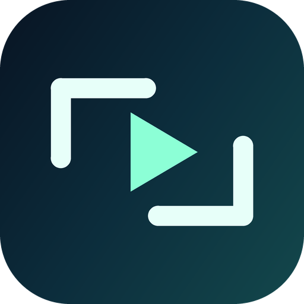
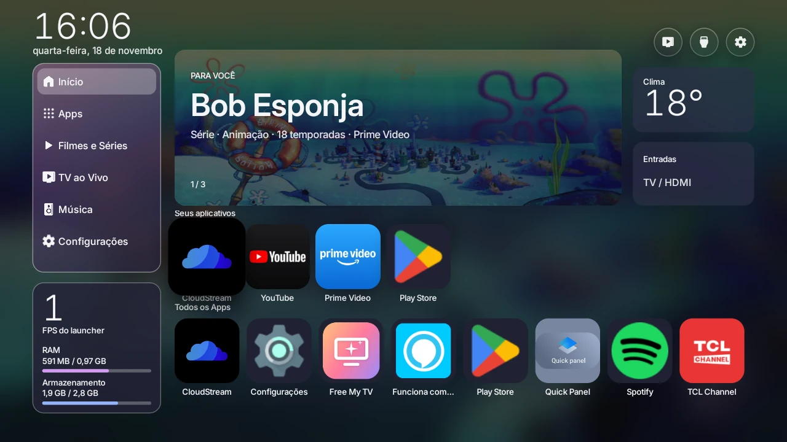
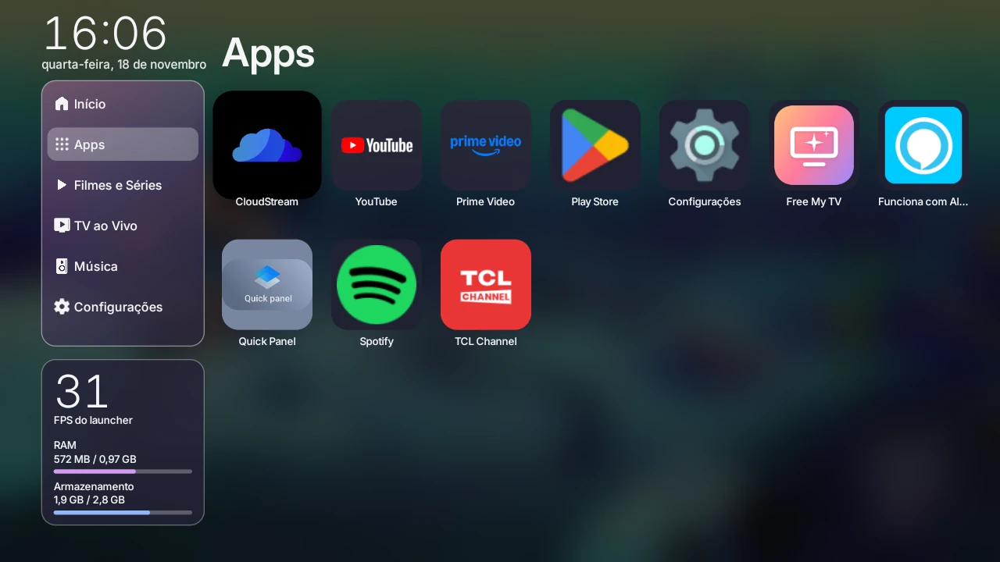
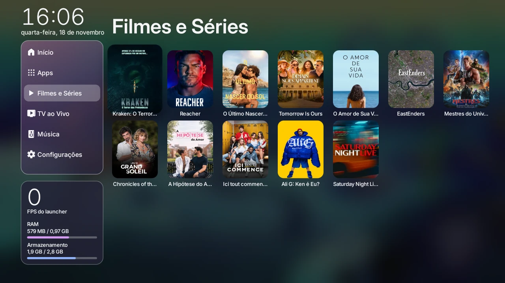
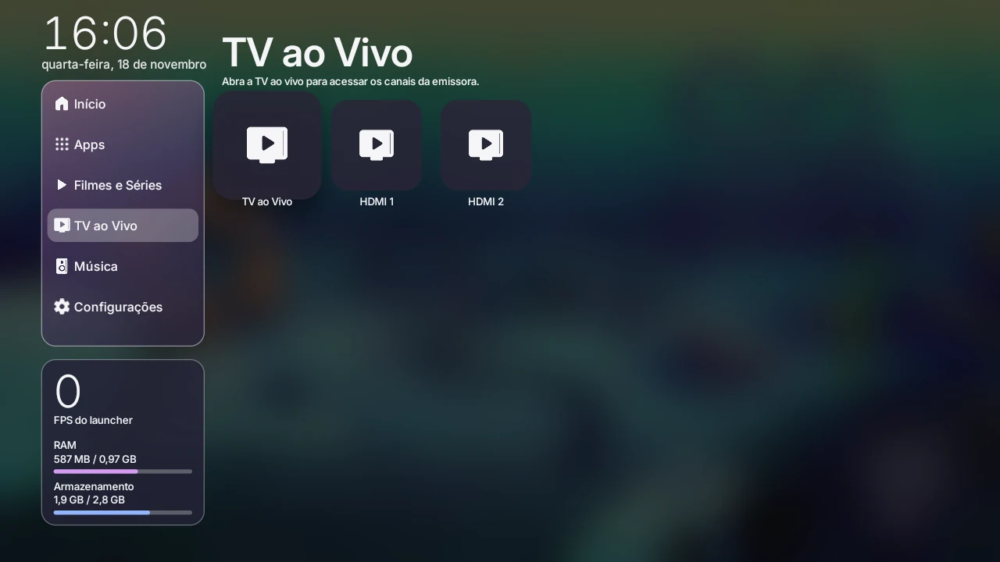
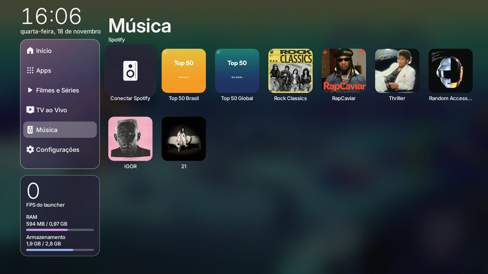
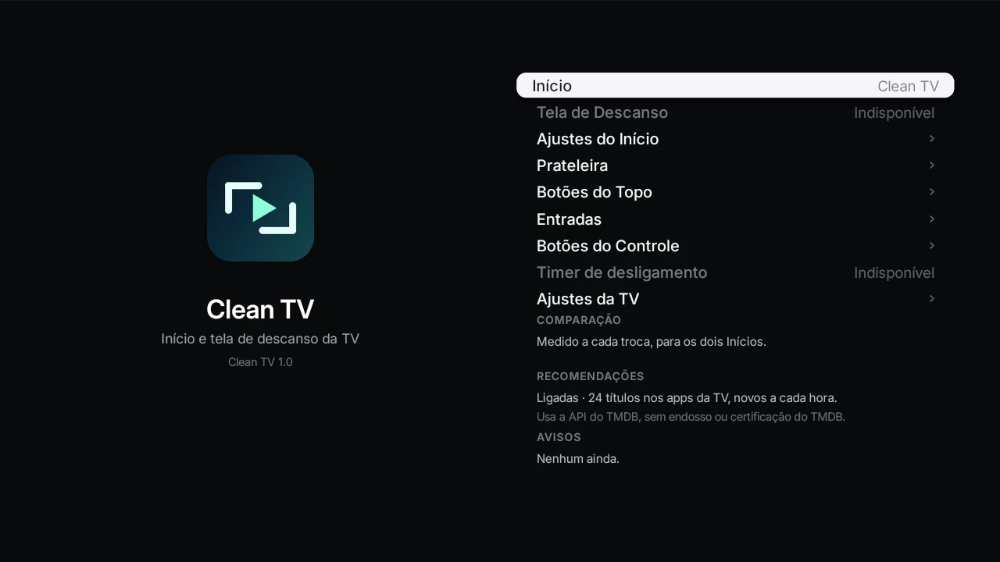
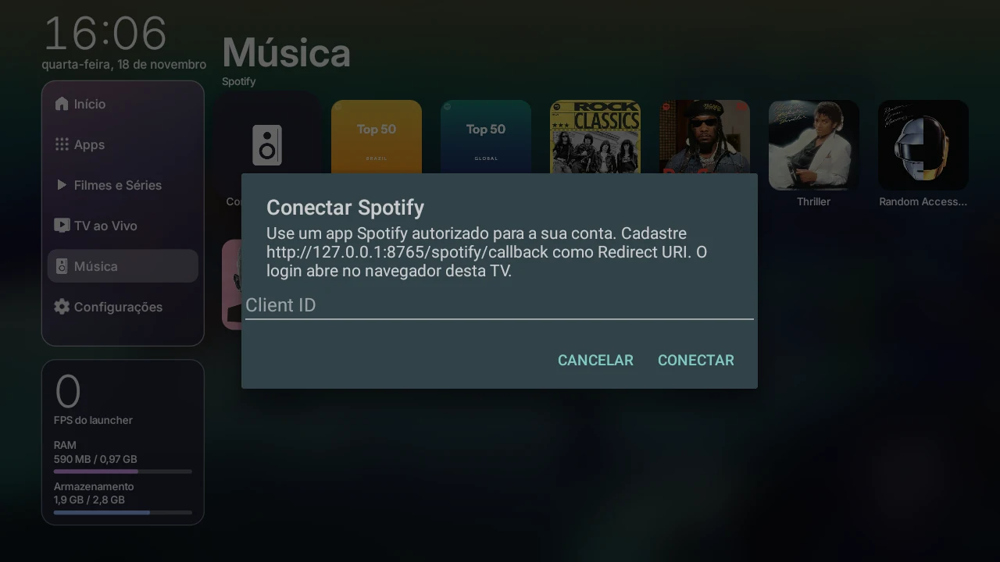

<div align="center">
  
  <h1>Clean TV</h1>
  <p>Tela inicial personalizável para Android TV e Google TV.</p>
</div>

Clean TV é um fork do [Free My TV](https://github.com/simbasjungles/free-my-tv) que reorganiza a experiência no Android TV em uma barra lateral e telas dedicadas. Ele reúne aplicativos, recomendações, entradas da TV e música numa interface feita para o controle remoto.

[Veja em ação](#veja-em-ação) · [Instalação](#instalação) · [Configurar TMDB](#configurar-tmdb) · [Seu próprio wallpaper](#seu-próprio-wallpaper) · [Spotify opcional](#spotify-opcional) · [Controles](#controles) · [Compatibilidade](#compatibilidade) · [Créditos](#créditos)

## Veja em ação



Capturas do **Clean TV 1.0** em uma TCL com Android TV 11, usando o fundo padrão e o TMDB configurado. Títulos, capas, aplicativos, canais e entradas podem variar conforme a TV.

### Navegação e animações


Use as setas para mover o foco entre os cartões. Na barra lateral, subir ou descer já troca a seção. Pressione **Direita** para entrar no conteúdo e **OK** para abrir o item.

### Telas disponíveis

| Apps | Filmes e Séries |
| --- | --- |
| [](docs/media/apps.webp) | [](docs/media/filmes-series.webp) |
| Apps instalados com ícones quadrados. | Catálogo do TMDB com filmes e séries em duas fileiras. |

| TV ao Vivo | Música |
| --- | --- |
| [](docs/media/tv-ao-vivo.webp) | [](docs/media/musica.webp) |
| Sintonizador e entradas disponíveis na TV testada. | Álbuns e playlists públicas sem precisar conectar uma conta. |

[](docs/media/configuracoes.webp)

Em **Configurações**, você pode ajustar o início, os favoritos, os botões do topo, as entradas e o controle.

## O que muda no Clean TV

| Área | O que você encontra |
| --- | --- |
| **Início** | Destaque do TMDB, duas fileiras de apps, relógio, clima e TV/HDMI. |
| **Apps** | Grade dos aplicativos que o Android TV disponibiliza ao launcher, com ícones quadrados quando fornecidos pelo app. |
| **Filmes e Séries** | Recomendações e pôsteres do TMDB, com até seis filmes e seis séries conforme o catálogo disponível. |
| **TV ao Vivo** | Canais que o sistema permite consultar e atalhos para sintonizador e HDMI. |
| **Música** | Álbuns e playlists públicas do Spotify com capas. A conexão à biblioteca pessoal é opcional. |
| **Configurações** | Ajustes de início, prateleira, botões do topo, entradas e controle remoto. |
| **Widget** | FPS de renderização do launcher e barras de memória RAM e armazenamento do dispositivo. |

A barra lateral troca de seção ao mover o foco. Os cartões compartilham a animação de foco, e a barra usa uma amostra desfocada da imagem de fundo quando um wallpaper fixo está incluído. O widget atualiza a leitura a cada segundo. Com a interface parada, o FPS pode chegar a zero porque não há quadros novos para renderizar.

## Instalação

### Android TV e Google TV

Você precisa de um computador com **JDK 17**, **Android SDK Platform 34**, **Build Tools 34** e **Android Platform Tools**. No Windows, execute o script em Git Bash. A versão mínima do APK é Android 8.0 (API 26).

1. Clone este fork e abra a pasta do projeto.
2. Configure a localização do SDK, se necessário, e compile o APK.

   ```bash
   export ANDROID_HOME="/caminho/para/Android/Sdk"
   ./build.sh --generic
   ```

3. Ative a depuração no menu de desenvolvedor da TV. Use o endereço e a porta mostrados pela sua TV e autorize a conexão no controle quando o Android pedir.

   ```bash
   adb connect IP_DA_TV:PORTA
   adb install -r CleanTV.apk
   ```

4. Abra **Clean TV** na lista de aplicativos. Configure seus ajustes e verifique a navegação antes de selecionar o Clean TV como tela inicial, se a TV oferecer essa escolha.

O script cria uma chave local de assinatura na primeira compilação, caso nenhuma seja fornecida. Guarde-a para poder atualizar a mesma instalação. O APK do fork usa um ID diferente do APK oficial do Free My TV, então ambos podem coexistir e têm configurações próprias.

### Definir como tela inicial

O Clean TV declara uma atividade Home do Android. A seleção e a persistência dependem do firmware. Na TCL Android 11 testada, a versão personalizada respondeu ao botão Home durante a sessão, mas o firmware restaurou a prioridade do launcher do Google depois do reinício. A seleção do launcher não altera a marca de inicialização gravada no firmware.

### Tizen e webOS

O fork mantém o código e a arte de empacotamento para as versões web herdadas do projeto original. As mudanças de interface, o widget e a integração pessoal do Spotify descritos neste README foram feitos para **Android TV**. As compilações web podem ser geradas localmente, mas não foram validadas em TVs Samsung ou LG neste fork.

```bash
python3 tizen/build.py --generic
python3 webos/build.py --generic
```

Para os requisitos específicos de instalação nessas plataformas, consulte a [documentação original](https://github.com/simbasjungles/free-my-tv). Use os pacotes gerados por este fork para obter a marca Clean TV.

## Configurar TMDB

**Para ver o layout completo demonstrado, configure uma chave do TMDB.** Ela habilita o destaque de recomendações no Início e preenche Filmes e Séries com títulos e pôsteres. Sem a chave, essas áreas dependentes do catálogo podem aparecer vazias ou dar lugar ao relógio, conforme o ajuste escolhido para o topo. Apps, configurações, entradas e a seleção pública de música funcionam independentemente da chave.

1. Crie uma conta no [The Movie Database](https://www.themoviedb.org/).
2. Solicite uma chave nas [configurações da API do TMDB](https://www.themoviedb.org/settings/api).
3. Na TV, abra **Configurações → Ajustes do Início → Chave TMDB** e cole a chave. Você pode usar o QR code do launcher, quando disponível, ou digitar com o controle.
4. Em **Topo da tela**, selecione a opção de recomendações. Ajuste a região e os serviços usados conforme a disponibilidade na sua TV.

## Seu próprio wallpaper

**O wallpaper pessoal mostrado nos testes não acompanha o código nem o APK compilado a partir do fork público.** Sem uma imagem sua, o Clean TV usa o fundo padrão do launcher. A chave do TMDB ativa o catálogo, e o wallpaper é uma configuração independente.

1. Escolha uma imagem que você possa usar. Para evitar distorção, prefira um **PNG 16:9**, por exemplo **1920 × 1080**. Se a imagem estiver em JPEG ou WebP, exporte-a como PNG em um editor de imagens.
2. Na pasta do repositório, copie o arquivo para `app/assets/home-wallpaper.png`. Use exatamente esse nome. O Git ignora esse caminho para manter a sua imagem local.
3. Recompile o APK e atualize a instalação na TV com a mesma chave de assinatura.

   ```bash
   ./build.sh --generic
   adb install -r CleanTV.apk
   ```

O PNG é incluído no APK que você gerar. Para trocar a imagem, substitua o arquivo e repita o passo 3. Para voltar ao fundo padrão, remova sua imagem da pasta local e recompile. O fundo usa uma imagem estática para evitar reprodução de vídeo em segundo plano. O efeito fosco da barra lateral é calculado a partir desse PNG.

## Spotify opcional

**Música** já oferece uma seleção pública de álbuns e playlists, incluindo Top 50 Brasil e Top 50 Global. As capas são carregadas quando aparecem na tela. Ao selecionar um item, o launcher tenta abri-lo no Spotify da TV.

Para exibir **suas** faixas de maior afinidade, álbuns salvos e playlists, abra **Música → Conectar Spotify**. Informe o **Client ID** de um app autorizado no Spotify for Developers e conclua a autorização no navegador da própria TV. O app deve registrar `http://127.0.0.1:8765/spotify/callback` como Redirect URI.

[](docs/spotify-android-tv.md)

Essa é a tela real de conexão, antes do login. O [guia ilustrado do Spotify](docs/spotify-android-tv.md) mostra o caminho da seleção pública até a autorização da conta.

Cada instalação autoriza sua própria conta. A integração usa OAuth com PKCE e dispensa Client Secret. O dono de um app em modo de desenvolvimento precisa ter Premium e adicionar as contas autorizadas no painel do Spotify. Consulte o [guia da integração](docs/spotify-android-tv.md) e as [regras do Spotify](https://developer.spotify.com/documentation/web-api/concepts/quota-modes).

A seleção pública com capas foi conferida na TCL. O login personalizado foi implementado e ainda precisa de validação ponta a ponta com uma conta autorizada e um navegador compatível na TV.

## Controles

- **Esquerda** na primeira posição de uma fileira ou grade leva à barra lateral.
- **Cima e baixo** na barra mudam a seção. **Direita** entra no conteúdo. **OK** abre o item em foco ou os ajustes.
- **Esquerda e direita** no destaque do Início percorrem as recomendações.
- **Voltar** fecha o painel aberto ou retorna ao Início.
- Em **Prateleira**, escolha os favoritos. Em **Botões do Topo**, ajuste os atalhos. Em **Entradas**, organize as fontes disponíveis. As opções dos botões físicos variam por controle e modelo.

## Compatibilidade

- **Android TV testada** em uma TCL com Android 11. Foram conferidos os menus, a navegação, o widget, os pôsteres do TMDB e as capas da seleção pública do Spotify.
- **Canais ao vivo** só aparecem individualmente quando o provedor da TV os expõe ao launcher. Na TCL testada, a opção de TV ao Vivo abre o sintonizador nativo, onde ficam os canais configurados.
- **Spotify** exige o app de reprodução instalado na TV para abrir as faixas e playlists diretamente. O serviço controla disponibilidade e reprodução conforme a conta e a região.
- **FPS** mede novos quadros desenhados pela janela do Clean TV. A leitura é específica do launcher e não mede os FPS de vídeos ou jogos abertos em outros apps.
- Os dados de RAM e armazenamento mostram o que o Android reporta como disponível para o dispositivo e sua partição de dados.
- As atualizações oficiais do Free My TV pertencem ao upstream. Instale atualizações do Clean TV com um APK do fork assinado pela mesma chave da sua instalação.

## Desenvolvimento

`app/src/io/freemytv/` contém o launcher Android e os ajustes. `HomeView.java` desenha a interface. `Recs.java` obtém o catálogo. `SpotifyLibrary.java` carrega música e cuida da autorização opcional. A identidade visual é gerada por `tools/make_art.py` e usada no Android, Tizen, webOS e nos recursos do site.

Para conferir as traduções e os testes existentes:

```bash
python3 tools/translate.py --check
bash tools/test-remote.sh
bash tools/test-order.sh
bash tools/test-net.sh
bash tools/test-web.sh
```

Ao abrir uma issue, inclua o modelo da TV, versão do Android, versão do Clean TV e passos para reproduzir. Omita chaves de API, tokens, endereços IP privados, números de série e dados de conta.

## Créditos

- [Free My TV](https://github.com/simbasjungles/free-my-tv) e seus colaboradores, pelo launcher original, ferramentas e suporte às plataformas. O Clean TV mantém os créditos e o aviso de copyright do projeto original.
- [TMDB](https://www.themoviedb.org/), pelos metadados e imagens do catálogo. Este projeto usa a API do TMDB e não é endossado nem certificado pelo TMDB.
- [Spotify](https://developer.spotify.com/), pelos metadados e capas de música, com reprodução no app oficial.

Código sob a [licença MIT](LICENSE). As marcas, capas e logotipos de terceiros pertencem a seus respectivos titulares.
