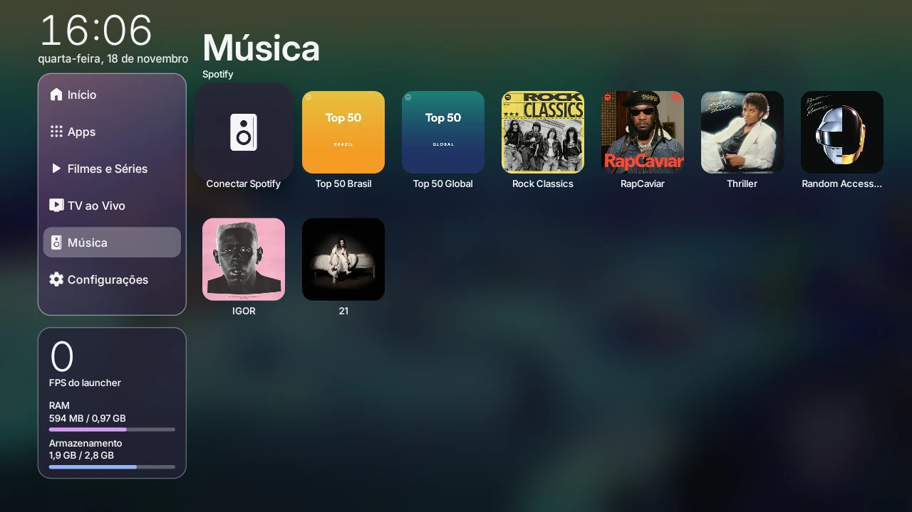
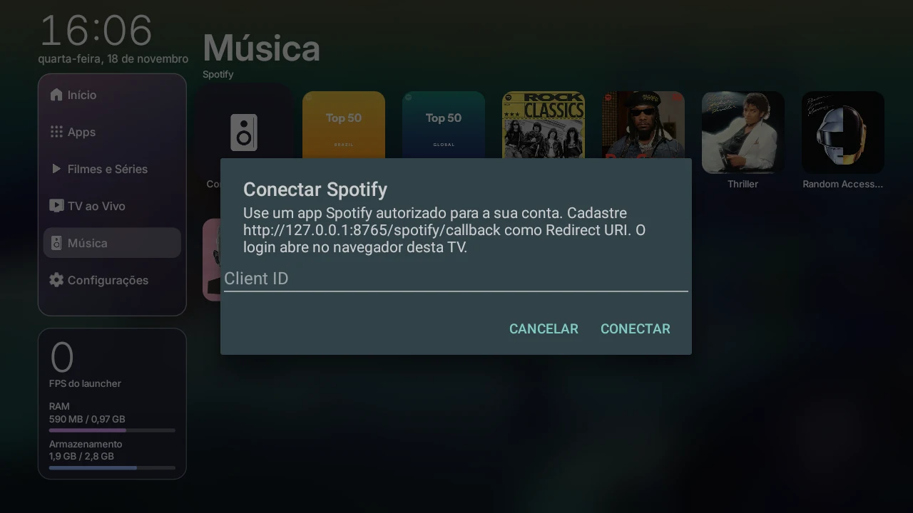
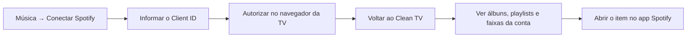

# Spotify no Android TV

A aba **Música** já vem com uma seleção pública de álbuns e playlists. As capas são carregadas quando aparecem na tela. Ao selecionar um item, o launcher tenta abri-lo no app Spotify da TV.

A seleção pública foi conferida na TV sem uma conta conectada. Você pode usar essa seção mesmo que prefira pular a configuração abaixo.

## Conectar sua biblioteca

1. No [Spotify for Developers](https://developer.spotify.com/dashboard), registre um app com acesso à **Web API**. O dono de um app em modo de desenvolvimento precisa ter Premium. Adicione as contas que poderão entrar em **Users Management**.
2. Cadastre `http://127.0.0.1:8765/spotify/callback` em **Redirect URIs**.
3. Na TV, abra **Música → Conectar Spotify**, informe o **Client ID** do app registrado e autorize no navegador da própria TV. O endereço de retorno é local à TV. Um navegador em outro aparelho não alcança esse endereço.

   

4. Volte ao launcher. A aba mostra suas faixas favoritas segundo o Spotify, álbuns salvos e playlists. Em **Conta Spotify**, você pode apagar a conexão salva nessa instalação.

A prévia usa OAuth com PKCE e guarda a autorização no armazenamento privado da instalação. Cada TV pode conectar uma conta diferente. Não é preciso informar um Client Secret. O launcher consulta metadados. A reprodução fica a cargo do Spotify.

## Como a conexão funciona

As imagens mostram a seleção pública e o formulário de conexão reais. O fluxo da biblioteca pessoal foi implementado e ainda precisa ser testado de ponta a ponta com uma conta autorizada, por isso não há uma captura de biblioteca conectada.
